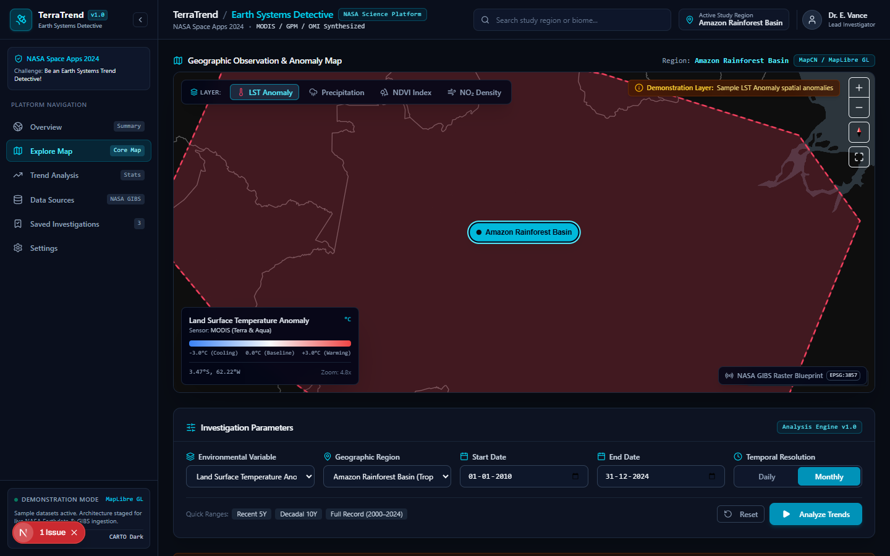

# TerraTrend — Earth Systems Trend Detective

[](https://www.spaceappschallenge.org/)
[](https://nextjs.org/)
[](https://fastapi.tiangolo.com/)
[](https://python.org/)
[](https://www.mapcn.dev/)
[](https://www.typescriptlang.org/)
[](LICENSE)

**TerraTrend** is a scientific research and exploration platform designed for the **NASA Space Apps Challenge: "Be an Earth Systems Trend Detective!"**. It empowers students, educators, researchers, and climate analysts to investigate historical environmental trajectories across geographic biomes and urban microclimates using verified NASA satellite observations and Earth system models.

---

## 1. Product Vision: The 4 Fundamental Questions

TerraTrend guides users to answer four core scientific questions about our changing planet:

1. **WHAT is changing?** (Land surface temperature, vegetation canopy greenness, monsoonal precipitation, or atmospheric composition)
2. **WHERE is it changing?** (Geographic bounding extents, global biomes, and localized microclimates)
3. **HOW MUCH is it changing?** (Robust non-parametric rates of change per year and per decade via Sen's slope estimator)
4. **Is the observed trend statistically significant?** (Mann-Kendall rank correlation, seasonal adjustments, and Pettitt change-point detection)

> **Scientific Integrity Disclaimer:** Statistical trend detection demonstrates observational historical change; it does not by itself establish mechanical causality or guarantee future continuation.

---

## Interactive Scientific Dashboard



---

## 2. System Architecture

```
D:\NASA-hcl/
├── src/                               # Next.js 16 App Router Frontend
│   ├── app/                           # Layouts, globals, and dashboard pages
│   ├── components/
│   │   ├── dashboard/                 # Controls, charts, statistics, guided workflow modal, report export
│   │   ├── layout/                    # Responsive sidebar and top navigation
│   │   ├── map/                       # MapCN + MapLibre GL geospatial map & view controller
│   │   ├── ui/                        # Accessible shadcn/ui components (badge, button, card, map)
│   │   └── views/                     # Overview, Deep Trend Analysis, Regional Comparison, Data Sources
│   ├── data/                          # Geographic study regions & environmental variable definitions
│   ├── services/                      # Typed backend API client & export generators (CSV, JSON)
│   └── types/                         # TypeScript interfaces for scientific data and configs
├── backend/                           # Python 3.12 FastAPI Scientific Backend
│   ├── app/
│   │   ├── main.py                    # Application lifecycle, CORS, route mounting
│   │   ├── api/endpoints/             # Health, datasets, regions, variables, data retrieval, analysis, timeseries
│   │   ├── core/                      # NASA Earthdata Login (URS) manager
│   │   ├── models/                    # Pydantic schemas (timeseries, grids, methods, provenance)
│   │   ├── providers/                 # 6 NASA mission provider modules (GPM, MODIS, AIRS, OMI, MERRA-2, GLDAS)
│   │   ├── registry/                  # Authoritative datasets, regions, and analytical methods
│   │   └── services/                  # CMR search, local cache, xarray processor, async jobs, trend analyzer
│   └── tests/                         # Pytest automated test suite (54 unit/endpoint + 6 live NASA CMR tests)
├── public/                            # Static icons and assets
└── data/                              # Local cache & granule directory (git-ignored)
```

---

## 3. Supported NASA Datasets

TerraTrend integrates six verified NASA satellite and model products:

| Dataset | Platform / Instrument | NASA Product Identifier | Key Variables | Units |
| :--- | :--- | :--- | :--- | :--- |
| **GPM IMERG** | GPM Core Observatory (DPR + GMI) | `GPM_3IMERGM.07` | Monthly Precipitation Rate | `mm/hr` |
| **MODIS Terra/Aqua** | Terra / Aqua (MODIS) | `MOD13A2.061`, `MOD11A2.061` | NDVI, EVI, Land Surface Temp | Dimensionless, `Kelvin` |
| **AIRS** | Aqua (AIRS-only V7 Climate Record) | `AIRS3STM.7.0` | Surface & Tropospheric Temp, Total Ozone | `Kelvin`, `Dobson Units` |
| **OMI** | Aura (OMI) | `OMTO3e.003`, `OMNO2d.003`, `OMAERUVd.003` | Total Column Ozone, Tropospheric NO₂, AOD | `Dobson Units`, `molec/cm²`, `Index` |
| **MERRA-2** | Goddard Earth Observing System (GEOS-5) | `M2TMNXSLV.5.12.4` | 2-meter Air Temp (`T2M`), Precipitation | `Kelvin`, `kg/(m²·s)` |
| **GLDAS Noah** | Land Data Assimilation System | `GLDAS_NOAH025_M.2.1` | Soil Moisture Profile, Evapotranspiration | `kg/m²`, `kg/(m²·s)` |

---

## 4. Key Capabilities

### A. Non-Parametric Scientific Trend Engine
- **Sen’s Median Slope:** Outlier-resilient pairwise median rate of change with Hollander-Wolfe rank-based 95% confidence intervals.
- **Mann-Kendall Rank Correlation:** Non-parametric test for monotonic trends with variance correction for tied values.
- **Seasonal Mann-Kendall Test:** Hirsch-Slack formulation accounting for 12-month annual seasonality cycles.
- **Pettitt’s Structural Break-Point Test:** Detection of abrupt historical regime shifts (pre- vs post-break means).
- **Standardized Climatological Anomalies:** Multi-year monthly baselines ($\mu_m, \sigma_m$) and $Z$-score departure identification ($|Z| \ge 2.0$ flagged as extremes).
- **Plain-Language Dynamic Interpretation:** Grounded natural-language synthesis generated from computed statistics.

### B. Regional Comparison Detective View
- Side-by-side comparative analysis of 2 to 5 regions simultaneously.
- Study regions include global biomes (Amazon Basin, Greenland Ice Sheet, Sahel Belt, Arctic Svalbard, Tibetan Plateau, Great Barrier Reef, Lake Chad, Western US Basin) and dedicated urban-environmental study sites:
  - **Coimbatore & Western Ghats Foothills** (rain-shadow vegetation & orographic gradients)
  - **Chennai Coastal Metropolis** (Northeast Monsoon cyclonic extremes & coastal urban heat)
  - **Madurai Vaigai River Basin** (semi-arid thermal stress & agricultural water drawdown)
- Computes pairwise Pearson temporal coherence ($r$) and decadal slope rankings.

### C. 13-Step Guided Investigation Workflow
Interactive step-by-step modal guiding students and researchers through:
1. Research Question Scoping
2. Variable Selection
3. Sensor & Dataset Identification
4. Spatial Boundary Delineation
5. Historical Observation Window
6. Temporal Aggregation Level
7. Quality Flag & Cloud Screening
8. Area-Weighted Spatial Mean Extraction
9. Non-Parametric Trend Detection
10. Robust Trend Magnitude (Sen's Slope)
11. Structural Break-Point Testing
12. Climatological Seasonality & Anomalies
13. Scientific Synthesis & Limitations

### D. Multi-Format Report Export
- **CSV:** Raw and aggregated observation records with timestamps, physical units, QA flags, and confidence intervals.
- **JSON:** Complete reproducible research package with DAAC provenance, coordinates, and diagnostic metrics.
- **Print / PDF Dossier:** Clean print-styled report with executive summaries, diagnostic tables, and official citations.

---

## 5. Getting Started

### Prerequisites
- **Node.js** >= 18.18.0
- **Python** >= 3.12
- **Git**

### Installation

1. **Clone the repository:**
   ```bash
   git clone https://github.com/SelvaKailashS/Untitled.git
   cd Untitled
   ```

2. **Frontend Setup (Next.js):**
   ```bash
   npm install
   cp .env.example .env.local
   npm run dev
   ```
   Open [http://localhost:3000](http://localhost:3000) in your browser.

3. **Backend Setup (Python FastAPI):**
   ```bash
   cd backend
   python -m venv .venv
   # Windows:
   .venv\Scripts\activate
   # Linux/macOS:
   source .venv/bin/activate

   pip install -e .
   cp .env.example .env
   uvicorn backend.app.main:app --host 127.0.0.1 --port 8000 --reload
   ```
   Interactive API documentation will be available at [http://127.0.0.1:8000/docs](http://127.0.0.1:8000/docs).

---

## 6. Running Automated Tests

### Backend Test Suite (FastAPI + Pytest)
```bash
# Run 54 offline unit and API endpoint tests:
pytest backend/tests -v -k "not test_integration_nasa"

# Run live NASA CMR catalog integration tests (requires network):
$env:RUN_NASA_LIVE_TESTS="1"; pytest backend/tests/test_integration_nasa.py -v
```

### Frontend Verification (TypeScript & Next.js Build)
```bash
# TypeScript strict check:
npx tsc --noEmit

# Next.js production build:
npm run build
```

---

## 7. License

This project is licensed under the MIT License — see the [LICENSE](LICENSE) file for details.
